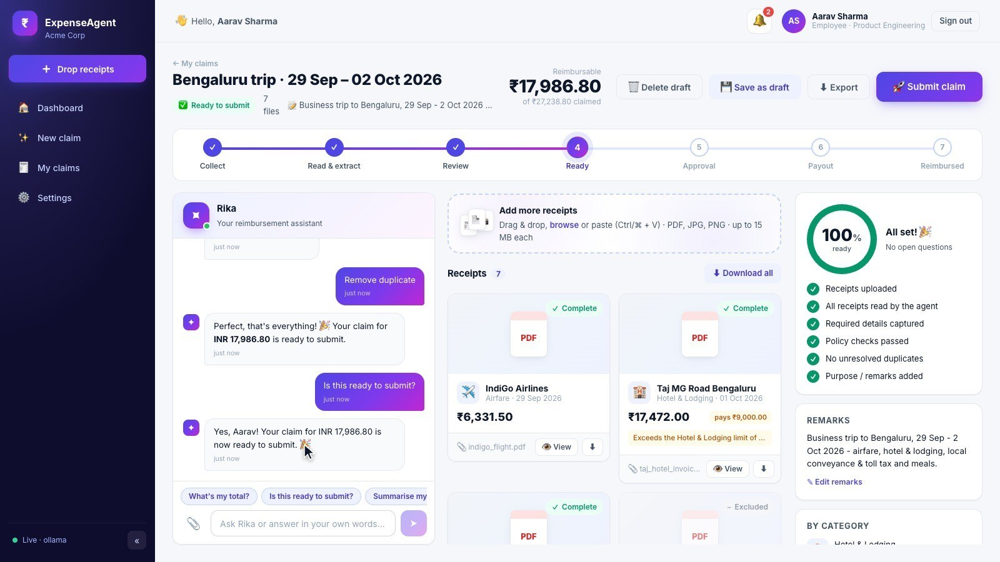

# Rika: AI Expense & Reimbursement Agent

**Track: AI Innovation Lab** · Author: Sunil Gurjar

| Deliverable | Where |
|---|---|
| 🎬 **Demo video** | YouTube: **`(https://www.youtube.com/watch?v=R_W8TpmYaWE)`** (4:20, narrated and captioned, also in [`docs/demo/`](docs/demo/)) |
| 📄 **Technical design document** | [`docs/TECHNICAL_DESIGN.md`](docs/TECHNICAL_DESIGN.md) (renders on GitHub with diagrams) · [PDF](docs/TECHNICAL_DESIGN.pdf) |
| 🧪 **Unit tests** | **831** backend tests (pytest, 100 % statement coverage) · **536** frontend tests (Vitest, 100 % lines), all passing. See [Testing](#testing) |
| 🌐 **Hosted instance** | Not hosted. Runs locally in about 5 minutes, see [Quick start](#quick-start) |



An AI-native reimbursement assistant. Employees drop photos, screenshots or PDFs of their bills into a chat-style workspace; the agent reads each document, extracts the details, categorises it, converts currency, checks policy, spots duplicates, asks **only the questions it needs**, and produces a submission-ready claim. A mocked corporate finance system then handles manager approval and payout.

- **Frontend:** Angular 21 (standalone components, signals, zoneless), custom SCSS design system with animations
- **Backend:** Python FastAPI, Pydantic v2, server-sent events for live progress
- **LLMs:** Ollama (local) and Claude (Anthropic), plus an offline rules engine as fallback, all switchable in configuration

---

## Quick start

### 1. Backend

```bash
cd backend
python3 -m venv .venv
source .venv/bin/activate
pip install -r requirements.txt
cp .env.example .env          # optional - add your Claude key here
python run.py                 # http://localhost:8100  (docs at /docs)
```

### 2. LLM (pick one)

| Provider | Setup |
|---|---|
| **Ollama** (default) | `ollama pull gemma3:4b`, keep `ollama serve` running |
| **Claude** | set `ERA_LLM__PROVIDER=claude` and `ERA_LLM__CLAUDE__API_KEY=sk-ant-...` in `backend/.env` |
| **Mock** | `ERA_LLM__PROVIDER=mock`, works offline, reads PDF text layers only |

You can also switch providers at runtime from **Settings** in the UI.

**Hindi / regional-language and handwritten bills.** Every receipt is read, checked, and (when checks fail or the
document isn't in English) re-read by a verification pass; names are transliterated, items translated, and dates
parsed day-first. `gemma3:4b` works but can still mix up adjacent handwritten table rows. For better accuracy use a
stronger OCR model - `ollama pull qwen2.5vl:7b` and set `llm.ollama.vision_model` - or Claude. Tune with
`pipeline.verify_mode` (`auto` | `always` | `off`) and `llm.ollama.zoom_tiles`.

### 3. Frontend

```bash
cd frontend
npm install
npm start                     # http://localhost:5200
```

### 4. Sign in with a demo account

Accounts live in [`backend/data/users.json`](backend/data/users.json) and are shown on the login page.

| Username | Password | Role |
|---|---|---|
| `employee` | `employee123` | Employee (reports to Meera) |
| `priya` | `priya123` | Employee (reports to Meera) |
| `manager` | `manager123` | Manager (approves the team's claims) |

### 5. Try it with the sample receipts

```bash
cd backend && python scripts/generate_samples.py   # writes ./samples
```

Drop everything from `backend/samples/` into a new claim. You'll see:
- a **flight, hotel, cabs, a dinner and a photo** of a café bill read in parallel, with a live per-receipt pipeline
- the **hotel capped** at the lodging limit (the agent asks for a justification)
- the **beer on the dinner bill deducted** as non-reimbursable
- the **duplicate Uber receipt** detected
- a **photo-only receipt** read by the vision model (Ollama/Claude)
- a few targeted questions, then **Ready to submit** → reference number → manager approval → payout notification

---

## Testing

Both suites are hermetic: no network, no real LLM, and no access to `backend/storage/`. Ollama and Claude are faked, and storage goes to a temporary folder.

```bash
# Backend: 831 tests, ~20 s
cd backend
pip install -r requirements-dev.txt
python -m pytest --cov=app --cov-report=term-missing

# Frontend: 536 tests, ~20 s
cd frontend
npx ng test --watch=false --coverage
```

| Suite | Tests | Coverage |
|---|---|---|
| Backend (pytest) | 831 passed | 100 % statements · 99.9 % with branches |
| Frontend (Vitest + jsdom) | 536 passed | 99.4 % statements · 100 % lines |

Writing the tests uncovered 11 real defects (for example, amounts printed without a thousands separator were misread by the offline parser). All are fixed and now covered by regression tests. See [§10.4 of the design doc](docs/TECHNICAL_DESIGN.md#104-defects-found-by-the-test-suite-and-fixed).

---

## The workflow

```
 Employee                               Agent (backend)                          Mock finance system
 ────────                               ───────────────                          ───────────────────
 Drop receipts ───────────────▶  Uploaded → Reading → Extracting (LLM)
                                 → Categorising → Policy check → Duplicates
 Live progress  ◀── SSE ───────  (each stage streamed to the UI)
 Answer questions ────────────▶  Only what's missing / questionable
 Chat ("what's my total?") ───▶  LLM with full claim context (can fill fields)
 Submit ──────────────────────▶  Readiness = 100% ──────────────────────▶  Reference EXP-YYYY-NNNNN
                                                                           Manager approves / returns
 Notifications  ◀───────────────────────────────────────────────────────  Payout after N seconds
```

Claim statuses: `draft → processing → needs_attention → ready → submitted → approved → paid` (or `rejected → reopened`).

Every step raises an in-app **notification** (bell + toast), pushed in real time over server-sent events.

---

## Configuration

Everything is configurable. Nothing is hard-coded in services.

| File | What it controls |
|---|---|
| [`backend/config/settings.yaml`](backend/config/settings.yaml) | app name/persona, server, auth/JWT, storage, **LLM provider & models**, fallback chain, pipeline timings, mock finance behaviour |
| [`backend/config/policy.yaml`](backend/config/policy.yaml) | categories, per-item limits, required fields, blocked items, receipt age, duplicate rules, FX rates |
| [`backend/data/users.json`](backend/data/users.json) | demo users, roles and reporting lines |
| `backend/.env` | overrides for any setting via `ERA_<SECTION>__<KEY>` (e.g. `ERA_LLM__PROVIDER=claude`) |
| [`frontend/public/config/app-config.json`](frontend/public/config/app-config.json) | runtime UI config: API URL, toast duration, quick chat prompts (no rebuild needed) |

---

## Project structure

```
backend/
  app/
    core/            settings (YAML + env), JWT, SSE event bus
    models/          domain models, API schemas, policy model
    repositories/    JSON-file persistence (claims, notifications, users)
    services/
      llm/           provider interface + Ollama, Claude, mock, registry (fallback, concurrency)
      document_reader.py      PDF text + page rendering, image normalisation
      extraction_service.py   multilingual 2-pass extraction: read → check → verify → translate
      extraction_checks.py    arithmetic / date / script sanity checks that drive the verify pass
      rule_extractor.py       regex parser for PDF text layers (offline mode + gap filling)
      purpose_service.py      writes the claim's remarks from its receipts
      policy_engine.py        limits, age, currency, blocked items, confidence
      duplicate_detector.py   file hash + fuzzy vendor/amount/date matching
      question_engine.py      the minimum set of questions to finish a claim
      claim_service.py        recompute: statuses, totals, groups, checklist, readiness
      agent_service.py        orchestrates the pipeline, answers and chat
      reimbursement_gateway.py  mocked finance system (refs, approvals, payouts)
    api/routes/      auth, claims, approvals, notifications + SSE, dashboard, settings
  config/            settings.yaml, policy.yaml
  data/users.json
  scripts/generate_samples.py
  tests/             pytest suite (831 tests) + shared fixtures and fakes

frontend/src/app/
  core/              config, auth (service, guards, interceptor), API clients, realtime (SSE), toasts, models
  layout/            shell (sidebar, top bar), notification bell, toast stack
  features/
    auth/login       animated login with demo-account picker
    dashboard        KPIs, spend by category, recent claims
    agent            ★ main workspace: chat + questions, drop zone, live receipt cards,
                       journey stepper, readiness ring, receipt drawer, submit dialog
    claims           list with filters, detail with status timeline
    approvals        manager queue and decision panel
    settings         LLM engine switcher and health checks, policy, profile
  shared/            readiness ring, status pill, count-up, confetti, pipes
  **/*.spec.ts       Vitest unit tests next to each unit (helpers in frontend/testing/)

docs/
  TECHNICAL_DESIGN.md / .pdf   technical design document (architecture, flows, AI, setup, tests)
  diagrams/                    every diagram as SVG and PNG
  demo/                        demo video, captions, thumbnail, YouTube description
  images/                      screenshots
  tools/render_pdf.py          regenerates the PDF and diagrams after editing the Markdown
```

## API overview

Interactive docs: http://localhost:8100/docs

| Method & path | Purpose |
|---|---|
| `POST /api/auth/login` · `GET /api/auth/me` · `GET /api/auth/demo-users` | authentication |
| `GET/POST /api/claims` · `GET/PATCH/DELETE /api/claims/{id}` | claims |
| `POST /api/claims/{id}/receipts` | upload (multipart, many files), processed in the background |
| `PATCH/DELETE /api/claims/{id}/receipts/{rid}` · `POST …/retry` · `GET …/file` | receipt edits |
| `POST /api/claims/{id}/questions/{qid}/answer` · `POST /api/claims/{id}/chat` | conversation |
| `POST /api/claims/{id}/submit` · `POST /api/claims/{id}/reopen` · `GET /api/claims/{id}/export` | lifecycle, CSV export |
| `GET /api/approvals` · `POST /api/approvals/{id}` | manager decisions |
| `GET /api/events/stream` | SSE: `claim.updated`, `notification` |
| `GET /api/dashboard` · `GET /api/config` · `GET/PUT /api/settings/llm` · `POST /api/settings/llm/{p}/test` | dashboard, policy, LLM settings |

## Notes

- Demo passwords are stored in plain text in `users.json` on purpose (dummy accounts). Use a real identity provider and hashed credentials in production, and change `auth.jwt_secret`.
- Data is persisted to `backend/storage/db.json` and uploads to `backend/storage/uploads/`. Delete that folder to reset.
- Claude calls use `claude-opus-5-5` by default with server-side refusal fallbacks enabled (`llm.claude.server_fallbacks`). Change models and effort in `settings.yaml`.
