# Rika — AI Expense & Reimbursement Agent
## Technical Design Document

| | |
|---|---|
| **Track** | **AI Innovation Lab** |
| **Author** | Sunil Gurjar |
| **Version** | 1.0 — October 2026 |
| **Source code** | GitHub: `<add your repository URL>` |
| **Demo video** | YouTube: `<add your video URL>` |
| **Hosted instance** | Not hosted. Runs locally in about five minutes (see [§9 Setup & deployment](#9-setup--deployment)) |

---

## Contents

1. [Project overview](#1-project-overview)
2. [System architecture](#2-system-architecture)
3. [Flow diagrams](#3-flow-diagrams)
4. [AI models & algorithms](#4-ai-models--algorithms)
5. [Data model](#5-data-model)
6. [API design](#6-api-design)
7. [Frontend design](#7-frontend-design)
8. [Configuration](#8-configuration)
9. [Setup & deployment](#9-setup--deployment)
10. [Testing & reliability](#10-testing--reliability)
11. [Code walkthrough](#11-code-walkthrough)
12. [Assumptions](#12-assumptions)
13. [Security & privacy](#13-security--privacy)
14. [Limitations & future work](#14-limitations--future-work)
15. [Appendix: sample receipts & expected behaviour](#appendix-a-sample-receipts--expected-behaviour)

---

## 1. Project overview

### 1.1 Track

This project is submitted under the **AI Innovation Lab** track. It uses vision-language models as part of a real business workflow, not as a bolt-on chatbot. The AI reads documents, checks its own work, and carries a claim from a pile of receipts to a payout. Deterministic rules keep every money decision auditable.

### 1.2 The problem

Expense reimbursement is a high-volume, low-value process that frustrates everyone involved:

| Who | Pain today |
|---|---|
| **Employees** | Type every bill into a form by hand. They also have to know which category and limit applies, convert currency, and remember the business purpose weeks later. Claims bounce back for one missing field. |
| **Managers** | Approve claims without context: no flags, no attachments side by side, no idea what was already deducted. |
| **Finance** | Catch duplicates, alcohol on dinner bills, over-limit hotels and stale receipts manually. Indian bills are often in Hindi, Marathi or other regional languages, or handwritten cash memos, which form-based tools and plain OCR handle poorly. |

### 1.3 The solution

**Rika** is a chat-first AI agent. Employees drop photos, screenshots or PDFs of their bills into a workspace. The agent then:

1. **reads** each document with a vision-language model (local **Ollama** or **Claude**, with an offline rules engine as fallback),
2. **double-checks** the reading with deterministic arithmetic, date and script checks, and **re-reads** the document when something doesn't add up,
3. **categorises** it against the company policy, **converts currency**, applies **limits**, **deducts non-reimbursable items** and **detects duplicates**, including duplicates of receipts in earlier claims,
4. **writes the claim's remarks** from the receipts, so the employee doesn't have to,
5. **asks only the questions it cannot answer itself**, shown as one-click cards or answered in free-form chat,
6. tracks a **readiness score**, and once it reaches 100 % submits the claim to a **mock corporate finance system**, which issues a reference number, routes the claim to the manager for approval and simulates the payout.

Every pipeline stage, notification and status change streams to the browser in real time over **server-sent events**.


### 1.4 Key features

| Area | Feature |
|---|---|
| **Document AI** | PDFs (text layer + rendered pages), photos and screenshots; multilingual and handwritten Indian bills; transliteration of merchant names, translation of items, day-first dates, Indic digits, paise columns |
| **Self-verification** | Two-pass extraction: deterministic checks find issues, the model re-reads with those issues as instructions, the better reading wins, and remaining doubts lower field confidence |
| **Policy engine** | 19 configurable categories with per-item limits and required fields, blocked items (alcohol, tobacco, spa, minibar…), receipt age, weekend warning, FX conversion, unknown currencies |
| **Fraud & error control** | SHA-256 exact duplicates and fuzzy duplicates (amount ± tolerance, date window, invoice number, vendor similarity), across all of the employee's claims |
| **Minimal questions** | A question engine computes the smallest set of questions needed to make the claim submittable. Questions keep stable ids, so answers stay attached as the claim changes |
| **Conversational agent** | The LLM chats with full claim context and can answer pending questions, correct receipt fields or set the purpose. Each action must be grounded in what the employee wrote (`ChatGuard`), then goes through the same server-side validation as the UI |
| **Workflow** | Draft → processing → needs attention → ready → submitted → approved/returned → paid; reopen and resubmit; CSV export; ZIP of all attachments |
| **Real time** | Live per-receipt pipeline progress, an in-app notification centre (bell + toasts), claim updates pushed to every open tab |
| **Pluggable AI** | Ollama (local, private), Claude (`claude-opus-5-5`) or an offline rules engine, switchable at runtime, with an automatic fallback chain |
| **Configurable** | Settings, policy, users and UI config are YAML/JSON files. Every setting can be overridden through `ERA_*` environment variables |

### 1.5 What is innovative

1. **Neuro-symbolic self-verification.** Small local vision models misread handwritten digits and table rows. Instead of trusting them, the system checks their output with deterministic rules: line items must add up to the total, quantity × rate must equal the amount, the date must be plausible and names must be in Latin script. Failed checks become **targeted instructions for a second reading**. The system keeps whichever reading passes more checks. Doubts that remain become low-confidence fields, which in turn become confirmation questions. A 4-billion-parameter model running on a laptop becomes usable for real financial data.
2. **"Ask only what's needed."** Most expense tools are forms. Here the form is replaced by a question engine that derives questions from the policy (required fields per category), from the extraction confidence, and from the policy flags (justification for over-limit, duplicate resolution). In practice a seven-receipt trip needs about two clicks.
3. **The LLM never decides money.** The model extracts facts. Limits, deductions, FX and duplicates are computed by the deterministic policy engine, and every decision is shown to the user as a flag. The result is explainable and auditable.
4. **Built for Indian documents.** The prompts and normalisers handle Devanagari and other Indic scripts and digits, *एकूण/कुल/योग* totals, *रु./पै.* columns, GSTIN vs invoice number confusion, dd/mm/yy dates, and regional fuel and medical vocabulary in the category keywords.
5. **Private by default.** With Ollama, documents never leave the machine. The same pipeline can switch to Claude for higher accuracy, or to the offline engine with no AI at all.
6. **Agent-written remarks with a privacy guard.** Rika drafts the purpose ("Business trip to Bengaluru, 1–3 Oct 2026 – airfare, hotel, local conveyance and meals") from receipt categories, cities and dates. The LLM may polish the draft but never adds people's names, and a remark written by the employee is never overwritten.
7. **Grounded chat actions.** In chat the model only *proposes* answers and corrections. A deterministic guard applies them only if they come from what the employee actually wrote, so a question like "What's my total?" can never fill in a justification (§4.13).

### 1.6 Users and roles

| Role | Capabilities |
|---|---|
| **Employee** | Create claims, upload receipts, answer questions, chat, edit receipts, submit, track, reopen returned claims, export |
| **Manager** | Everything an employee can do, plus an approval queue for direct reports with full receipt detail and attachments; approve or return with a comment |
| **Finance (mock)** | Simulated: issues reference numbers and pays out approved claims after a configurable delay |

### 1.7 Scope

In scope: the end-to-end employee and manager experience, document AI, the policy engine, the approval workflow and real-time UX. Out of scope (mocked): the real ERP/payroll integration, the corporate identity provider and the production database (see [§12](#12-assumptions) and [§14](#14-limitations--future-work)).

---

## 2. System architecture

### 2.1 High-level architecture

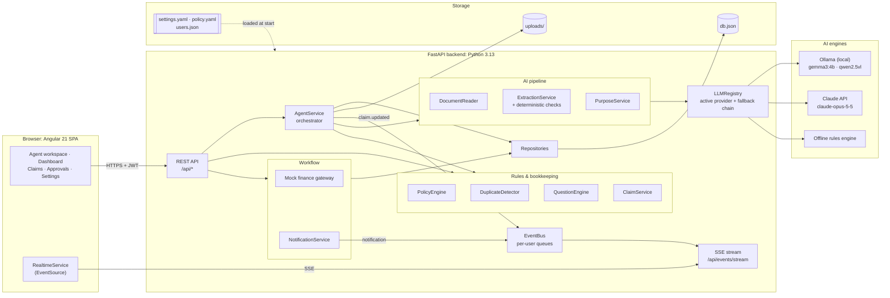

### 2.2 Backend layers

The backend follows a layered design. A single **composition root** ([`app/container.py`](../backend/app/container.py)) builds each service exactly once (lazily, with `cached_property`) and injects its dependencies through constructors, so services never import one another's globals. That keeps every unit testable in isolation.

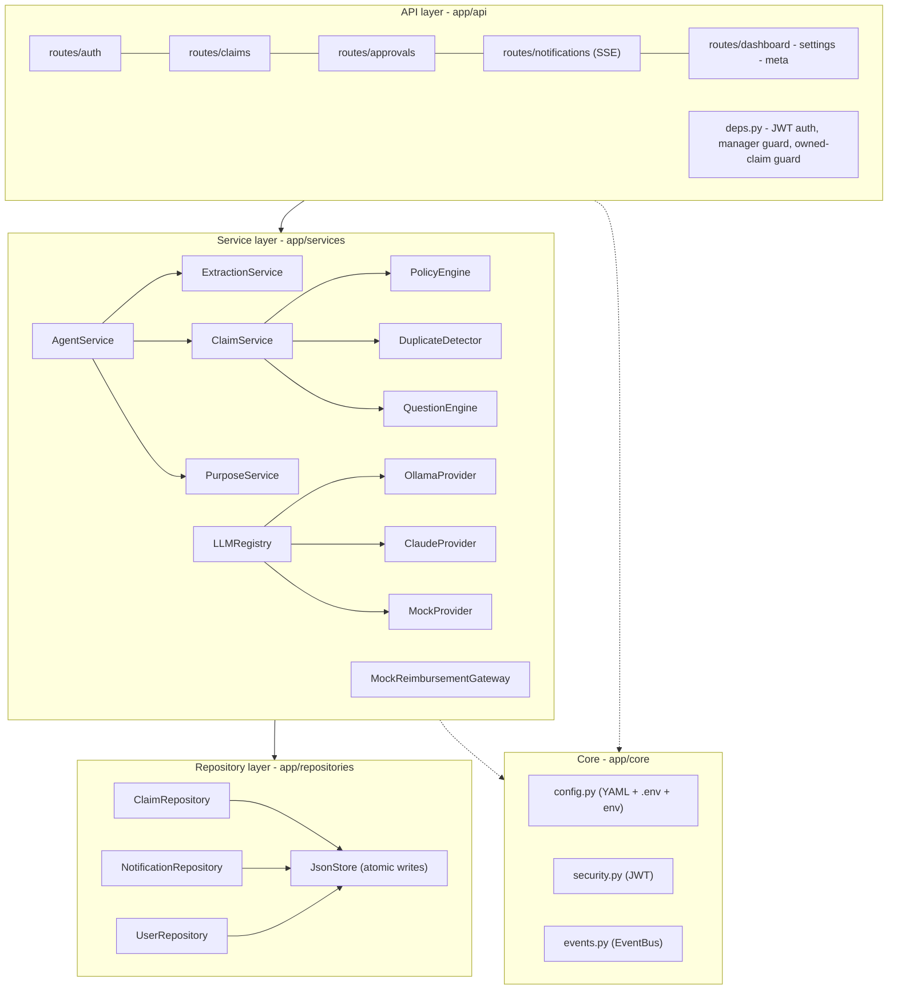

### 2.3 Component responsibilities

| Component | File | Responsibility |
|---|---|---|
| `AgentService` | [`services/agent_service.py`](../backend/app/services/agent_service.py) | Orchestrates the per-receipt pipeline in background tasks, uploads, answers, chat, batch summaries and notifications |
| `DocumentReader` | [`services/document_reader.py`](../backend/app/services/document_reader.py) | PDF text layer (pypdf) plus page rendering (pdfium); EXIF-aware image normalisation to ≤1600 px JPEG |
| `ExtractionService` | [`services/extraction_service.py`](../backend/app/services/extraction_service.py) | Prompting, JSON normalisation, gap-filling from the text layer, the verification pass, localisation, confidence finalisation |
| `extraction_checks` | [`services/extraction_checks.py`](../backend/app/services/extraction_checks.py) | Deterministic sanity checks that drive the verification pass |
| `normalizers` / `rule_extractor` | [`services/normalizers.py`](../backend/app/services/normalizers.py), [`services/rule_extractor.py`](../backend/app/services/rule_extractor.py) | Tolerant parsing of model output; regex extraction from PDF text layers |
| `PolicyEngine` | [`services/policy_engine.py`](../backend/app/services/policy_engine.py) | Categorisation; flags; FX; deductions; caps; confidence checks |
| `DuplicateDetector` | [`services/duplicate_detector.py`](../backend/app/services/duplicate_detector.py) | Exact (hash) and fuzzy duplicate matching against earlier receipts |
| `QuestionEngine` | [`services/question_engine.py`](../backend/app/services/question_engine.py) | Minimum set of questions to make a claim submittable |
| `ClaimService` | [`services/claim_service.py`](../backend/app/services/claim_service.py) | `recompute()`: statuses, totals, category groups, checklist, readiness, auto-title; applying answers and edits with validation |
| `PurposeService` | [`services/purpose_service.py`](../backend/app/services/purpose_service.py) | Deterministic remarks draft + LLM polish with a privacy guard |
| `ChatGuard` | [`services/chat_guard.py`](../backend/app/services/chat_guard.py) | Accepts an answer, field update or remarks proposed by the chat model only if it is grounded in the employee's latest message |
| `MockReimbursementGateway` | [`services/reimbursement_gateway.py`](../backend/app/services/reimbursement_gateway.py) | Reference numbers, manager routing, auto-approval, decisions, scheduled payouts |
| `LLMRegistry` + providers | [`services/llm/`](../backend/app/services/llm/) | Provider-agnostic requests, active provider, fallback chain, concurrency limit |
| `EventBus` | [`core/events.py`](../backend/app/core/events.py) | In-process pub/sub feeding SSE connections |
| Repositories | [`repositories/`](../backend/app/repositories/) | JSON-file persistence with atomic writes (temp file + `os.replace`) |

### 2.4 Frontend architecture

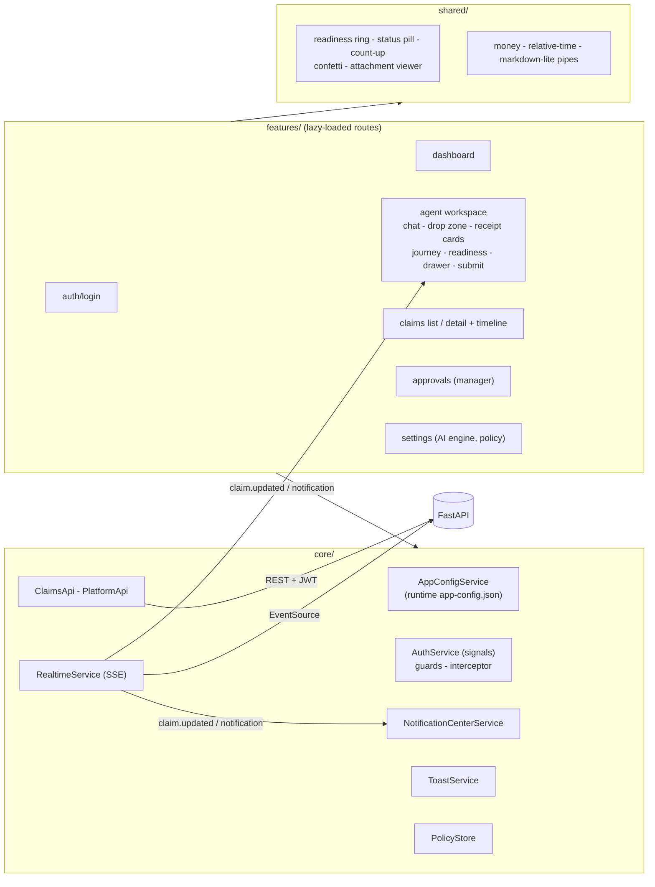

### 2.5 Deployment view

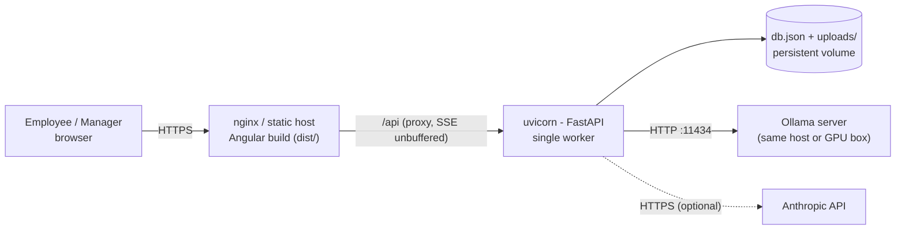

### 2.6 Technology stack

| Layer | Technology | Why |
|---|---|---|
| Frontend | Angular 21 (standalone components, **signals**, zoneless change detection, new control flow, view transitions), SCSS design system | Modern reactive UI with fine-grained updates, which suits a live, constantly changing claim |
| Backend | Python 3.13, **FastAPI**, Pydantic v2, pydantic-settings, uvicorn | Async I/O for parallel LLM calls and SSE; typed models end to end |
| Documents | pypdf (text layer), pypdfium2 (rendering), Pillow (normalisation, zoom tiles) | Pure-Python wheels with no system dependencies |
| AI | Ollama (`gemma3:4b` by default, `qwen2.5vl:7b` recommended for handwriting), Anthropic SDK (`claude-opus-5-5`, effort control, native PDF input, server-side fallbacks) | Local/private and cloud/high-accuracy options behind one interface |
| Auth | PyJWT (HS256 bearer tokens) | Stateless, simple |
| Real time | Server-sent events + in-process EventBus | One-way push is all that's needed; works through proxies; auto-reconnects |
| Persistence | JSON file store with atomic writes | No setup for a demo; repositories isolate it so swapping in a database is easy |
| Testing | pytest, pytest-asyncio, pytest-cov, httpx `MockTransport`; Vitest + jsdom through Angular's unit-test builder | Fast, hermetic unit tests (no network, no real LLM) |

---

## 3. Flow diagrams

### 3.1 End-to-end journey

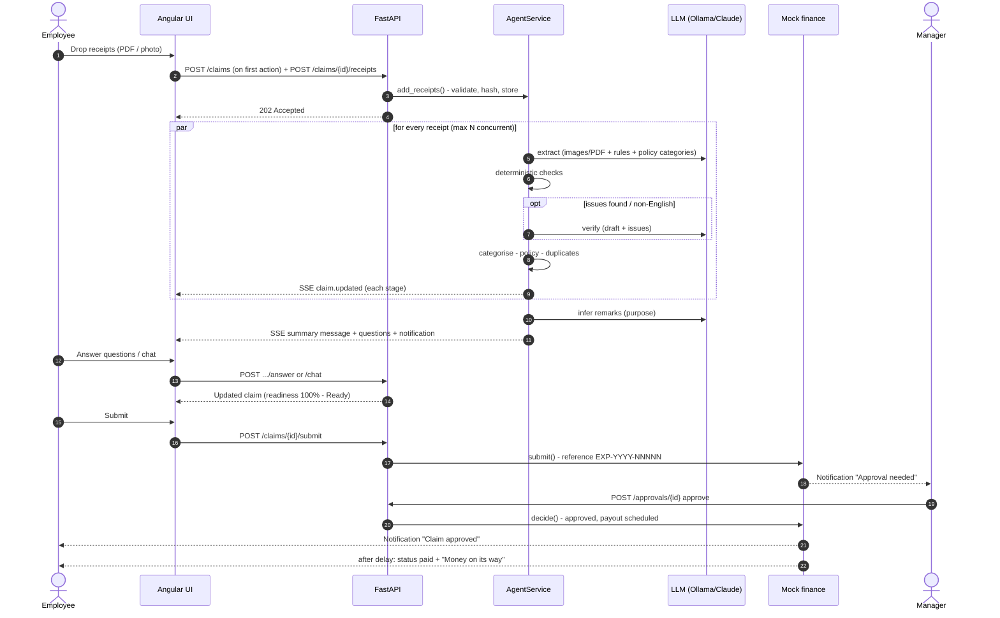

### 3.2 Receipt processing pipeline

Each receipt moves through these stages in its own background task. Every transition is persisted and pushed to the browser, so the UI shows a live stepper per receipt. A small configurable delay (`pipeline.stage_delay_ms`) keeps fast stages visible.

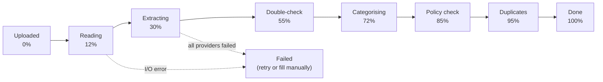

| Stage | What happens | Code |
|---|---|---|
| Reading | PDF → text layer + up to 3 pages rendered at 150 DPI; image → EXIF transpose, RGB, ≤1600 px, JPEG q88 | `DocumentReader.read` |
| Extracting | LLM call with the document, Indian-bill reading rules, JSON schema and policy categories; normalisation; gap-fill from the text layer | `ExtractionService.extract` |
| Double-check | Deterministic checks → optional verification re-read → translation of leftovers → confidence finalisation | `review`, `should_verify`, `verify`, `localise`, `finalise` |
| Categorising | Keep a specific model-chosen category unless an exclusion applies, otherwise keyword scoring | `PolicyEngine.categorise` |
| Policy check | Required fields, dates, FX, blocked items, limits, confidence | `PolicyEngine.evaluate` |
| Duplicates | Hash and fuzzy matching against earlier receipts in all the employee's claims | `ClaimService.recompute` → `DuplicateDetector.find` |

When the whole batch finishes, the agent infers the claim's remarks, recomputes the claim, posts a summary chat message and raises a notification.

### 3.3 Two-pass extraction with self-verification

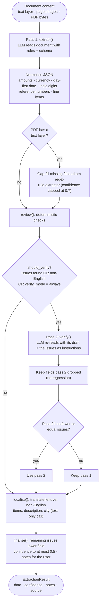

### 3.4 Claim lifecycle

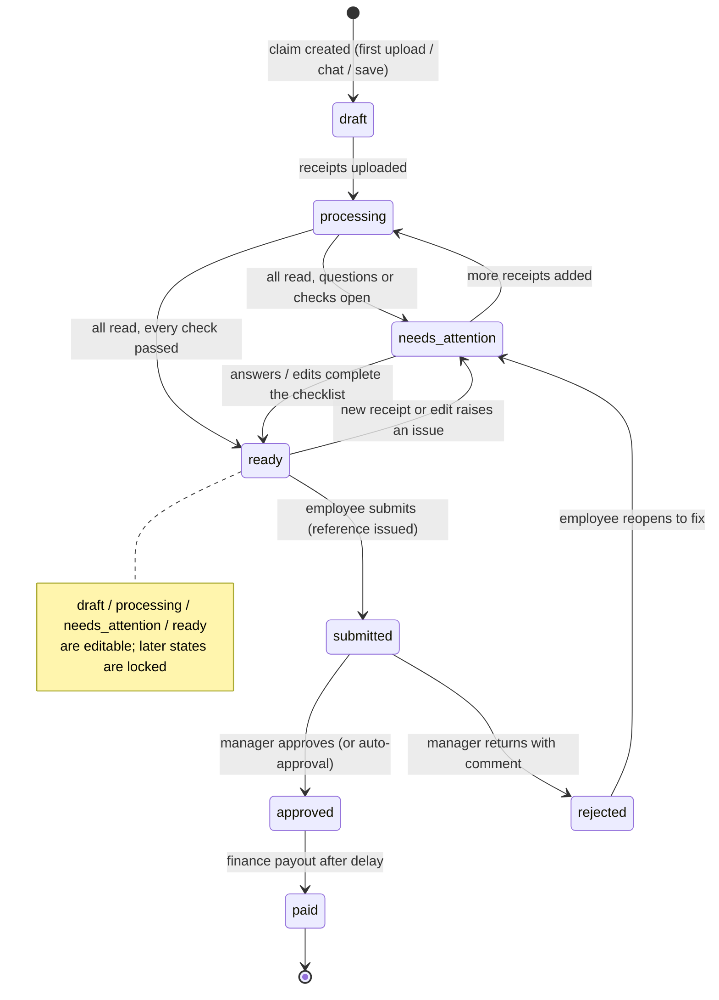

The status is never set by hand. `ClaimService._derive_status()` computes it from the receipts, the open questions and the checklist on every change, so the status and the data can't drift apart.

### 3.5 Question engine

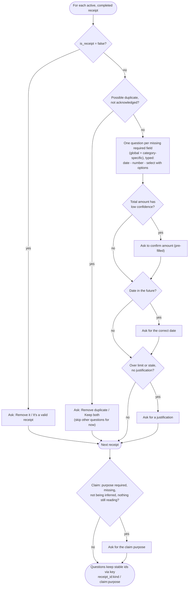

### 3.6 Approval and payout

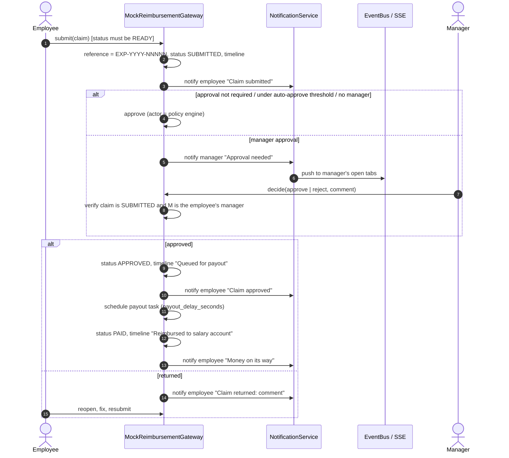

Reference numbers come from a persisted counter that never goes back, so numbers aren't reused after deletions. A returned claim keeps its reference when it is resubmitted. Approved claims whose payout hadn't happened yet are rescheduled when the server starts (`resume_pending_payouts`). Receipts that were mid-pipeline are re-queued (`resume_interrupted`).

### 3.7 Real-time updates

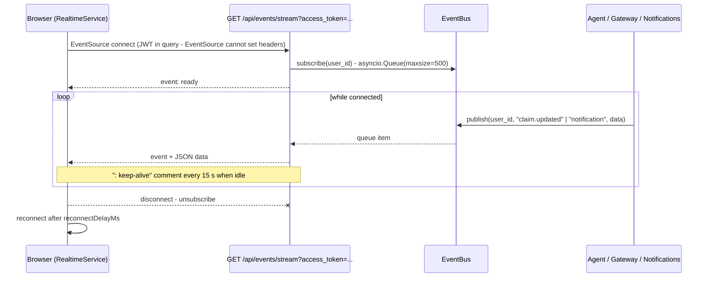

On the client, the workspace applies a pushed claim snapshot only if its `updated_at` is not older than the one on screen, so a late HTTP response can't overwrite a newer SSE update or the other way round.

### 3.8 LLM provider selection and fallback

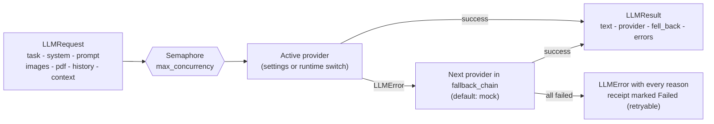

`OllamaProvider` sends the full page plus two overlapping zoomed halves to small models, which makes handwriting legible. `ClaudeProvider` sends PDFs as native document blocks, sets `output_config.effort` per task (medium for extraction, low for chat), turns `stop_reason == "refusal"` into an `LLMError` so the fallback chain takes over, and can enable Anthropic's server-side fallback beta. `MockProvider` reads PDF text layers with regexes and handles chat through intent matching, so the product works fully offline.

### 3.9 Conversational agent with structured actions

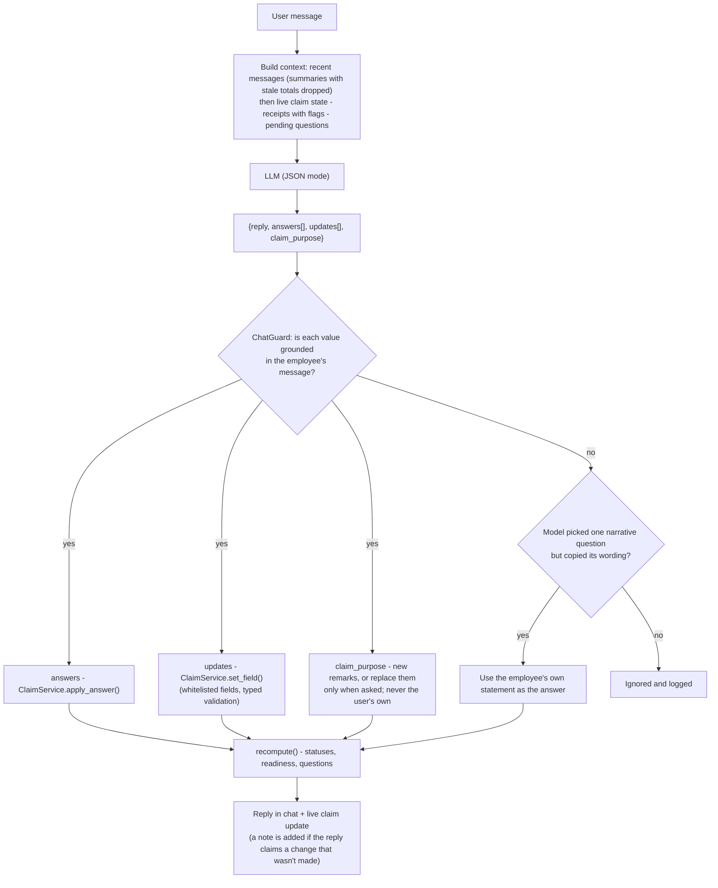

The model can't submit, approve or delete anything. Its actions are limited to the same field-level operations the UI offers, and they go through the same validation (`AnswerError` rejects invalid values). Before that, `ChatGuard` (§4.13) makes sure every value comes from what the employee actually wrote.

---

## 4. AI models & algorithms

### 4.1 Document understanding

* **PDFs.** pypdf extracts the text layer (first `max_pdf_pages` = 3 pages), and pdfium renders the same pages at 150 DPI. Claude receives the original PDF as a native `document` block. Ollama receives the page images, and the text layer is added to the prompt as a hint, truncated to 6,000 characters.
* **Images.** Orientation is fixed via EXIF, the image is converted to RGB, downscaled to at most 1600 px and re-encoded as JPEG (q88) to keep payloads small.
* **Zoom tiles.** For photos and scans (documents with no text layer), Ollama also receives two overlapping crops of the page: the top 58 % and bottom 58 % for portrait pages, left and right for landscape. That lets a 4B model read small or handwritten text. At most 6 images are sent.

### 4.2 Prompt design

The extraction prompt ([`extraction_service.py`](../backend/app/services/extraction_service.py)) combines:

* a **system prompt** that sets the role (accounts-payable expert), forbids invented values (use `null`) and requires a single JSON object;
* **reading rules** for Indian documents: read in the original script but answer in English; transliterate merchant names (*मनिष सर्विस सेंटर → Manish Service Center*) and keep the original in `vendor_local`; the vendor is the issuing outlet, not the franchise brand; dates are day-first and must also be copied verbatim into `date_as_printed`; recognise *एकूण / कुल / योग / Total*; combine the *पै.* paise column; a GSTIN is not an invoice number; read tables row by row; cross-check quantity × rate = amount; diesel implies a car;
* an explicit **JSON shape** with per-field confidence (0–1), line items and notes;
* the **policy's category keys and labels**, injected from `policy.yaml`, so adding a category needs no code change.

The **verification prompt** contains the draft and the list of failed checks, phrased as instructions ("Line items add up to 1,240.00 but the total is 1,840.00…"). When no check failed but the document isn't in English, it asks the model to re-check row assignment, digits, the date and the city.

### 4.3 Normalisation of model output

LLM output is treated as untrusted. [`normalizers.py`](../backend/app/services/normalizers.py) tolerates code fences and surrounding prose (it parses the first `{…}` block). It converts Devanagari, Bengali, Gujarati, Gurmukhi, Tamil, Telugu, Kannada and Malayalam digits to ASCII, parses amounts such as `"Rs. 1,178.82"`, maps currency symbols (₹, Rs, रु, $, €, £) to ISO codes, and parses dates **day-first** in 12 formats. It also removes spaces inside numeric bill numbers (`"0 14821"` → `"014821"`) and detects non-Latin letters (code point > U+024F). The model's ISO `date` is used only when the verbatim `date_as_printed` can't be parsed, because models often mis-convert dd/mm/yy.

### 4.4 Deterministic checks

[`extraction_checks.find_issues()`](../backend/app/services/extraction_checks.py) produces `Issue(field, message)` objects. The message doubles as an instruction for the verifying model.

| Check | Rule |
|---|---|
| Merchant | present; written in Latin letters (otherwise transliterate) |
| Total | present |
| Date | present, valid, not in the future, not older than 730 days |
| Totals agree | Σ line items ≈ total, or Σ line items + tax ≈ total |
| Line ≤ total | no single line item above the total (+1 %) |
| Row arithmetic | quantity × unit price ≈ amount (only when totals disagree) |
| City | short English place name: no digits, colons or non-Latin script, ≤ 40 characters |
| Items in English | no non-Latin line-item descriptions |

"≈" is `amounts_close(a, b)`: |a − b| ≤ max(1.0, 2 % of b).

### 4.5 Verification policy, gap-filling and reconciliation

* `pipeline.verify_mode`: `auto` re-reads only when a check fails, the document isn't in English, or a local-script vendor name was found; `always` re-reads every receipt; `off` does a single pass. The offline engine is never asked to verify.
* **Keep-the-better reading.** Pass 2 is accepted only if it has **no more issues** than pass 1. Fields that pass 2 dropped are copied back from pass 1, so verification never loses information.
* **Gap-filling.** If a model skips fields that are plainly printed in a PDF text layer, the regex rule extractor fills vendor, date, total, currency, tax, invoice number and location, with confidence capped at 0.7 and a note for the user.
* **Line-item reconciliation.** A common misreading is "Item × 2 64.00" read as a unit price of 64. If the unit prices (not the amounts) sum to the total, the system swaps them and recomputes the unit prices.
* **Localisation.** A cheap text-only call translates any remaining non-English line items or description, and reduces a printed address to an English city or area.

### 4.6 Confidence model

Each extracted field carries a confidence (the model's own value, or 0.8 by default). Gap-filled fields are capped at 0.7, and fields with unresolved issues at 0.5. For vendor, date and total, a confidence below `low_confidence_threshold` (0.6) raises a `LOW_CONFIDENCE` flag. For the total, it also raises a pre-filled **"confirm amount"** question. Any value confirmed by the user gets confidence 1.0 and is recorded in `confirmed_fields`.

### 4.7 Categorisation

`PolicyEngine.categorise()`:

1. If the model chose a specific category other than `other`, and none of that category's `excludes` words appear in the document, keep it.
2. Otherwise score every category by keyword hits over the vendor (Latin and original script), description, line items, the first 1,500 characters of the text layer and the file name. Latin keywords match **whole words** (regex `\b`). Indic keywords match as substrings, because `\b` is unreliable for Devanagari.
3. Categories whose `excludes` words appear are skipped (for example, a two-wheeler category can't be chosen for a diesel bill). The highest score wins, and on a tie the category listed earlier in `policy.yaml` wins.

### 4.8 Policy evaluation

`PolicyEngine.evaluate()` fills in `missing_fields`, `flags`, `amount_in_base` and `reimbursable_amount`:

| Flag | Severity | Rule |
|---|---|---|
| `UNREADABLE` | warning | photo/scan with no AI engine available (offline engine reads only text layers) |
| `NOT_A_RECEIPT` | error | model says the document isn't a receipt or invoice |
| `FUTURE_DATE` | error | date after today |
| `STALE_RECEIPT` | error (warning once justified) | older than `max_receipt_age_days` (90) |
| `WEEKEND` | info | Saturday/Sunday, when `weekend_expenses: warn` |
| `UNKNOWN_CURRENCY` | error | currency not in `fx_rates` |
| `FOREIGN_CURRENCY` | info | converted to INR at the policy rate |
| `NON_REIMBURSABLE_ITEMS` | warning | blocked keyword in line items (**those items are deducted**) or in the description/vendor |
| `OVER_LIMIT` | warning | reimbursable amount > category `limit_per_item` (**capped at the limit**) |
| `POSSIBLE_DUPLICATE` | warning | duplicate detected and not acknowledged |
| `LOW_CONFIDENCE` | info | vendor/date/total confidence < 0.6 and not confirmed |

Money is computed in this order: `amount_in_base = total × fx_rate`, then blocked items (also converted) are deducted, then the result is capped at the category limit. Required fields are the global `required_fields` plus the category's `requires` (for example meals need `business_purpose`, and client entertainment needs `attendees` and `business_purpose`). Receipts in categories that need a business purpose **inherit the claim's remarks** automatically, unless the employee wrote a specific purpose for that receipt.

### 4.9 Duplicate detection

`DuplicateDetector.find(receipt, candidates)` looks only at receipts **uploaded earlier**, ordered by `(uploaded_at, id)`, so the first copy counts as the original. Candidates come from every claim of the same employee, which catches re-claims across submissions. A receipt counts as a duplicate when:

* its **SHA-256** equals an earlier file's, or
* both are fully processed and the base amounts are within `amount_tolerance` (₹1) **and** the dates are within `date_window_days` (2), **and** either the **invoice numbers match** or the **vendor similarity** (`difflib.SequenceMatcher` ratio) is ≥ 0.75.

The UI says where the original lives ("in this claim" or "in your claim *Mumbai trip* (EXP-2026-00012)"), and the question engine offers *Remove duplicate* or *Keep both*.

### 4.10 Readiness score

`ClaimService._refresh_checklist()` evaluates six items: receipts uploaded, all receipts read, required details captured, policy checks passed (no error flags and no missing justifications), no unresolved duplicates, and purpose/remarks added. **Readiness = round(100 × done / 6).** The claim is `ready` only when every item is done and no question is open.

### 4.11 Purpose (remarks) inference

1. **Deterministic draft.** `PurposeService.summarise()` builds a sentence from the unique category labels, the claim period and the most frequent city. Example: *"Business trip to Bengaluru, 1–3 Oct 2026 – airfare, hotel & lodging, local conveyance & toll tax and meals."* When no travel category is present it writes *"Business expenses (…): …"* instead.
2. **LLM polish.** The model may rewrite the draft as one clear sentence of at most 22 words. It must keep dates, places and every kind of spend, may add a reason only if a receipt clearly shows one, and must never include names.
3. **Privacy guard.** Any output that mentions part of the employee's name is discarded in favour of the draft.
4. **Precedence.** A purpose written by the user is never overwritten by the agent (`purpose_source`).

### 4.12 Concurrency and resilience

* An `asyncio.Semaphore(max_concurrency)` around every LLM call protects local GPUs and API rate limits, while receipts are still processed concurrently.
* Each receipt runs in its own task, and one bad file can't break the batch. `LLMError`, `OSError` and `ValueError` mark only that receipt as `failed`, with a readable error, a **Retry** button and manual editing.
* If a claim is deleted or submitted while a receipt is still being processed, the pipeline stops cleanly (`_ReceiptGone`).
* PDF parsing goes through a global lock because pdfium isn't thread-safe. Blocking I/O runs in `asyncio.to_thread`.
* The JSON store writes atomically (temp file + `os.replace`), so a crash can't leave a half-written database.
* On startup the server resumes interrupted receipts and pending payouts.

### 4.13 Grounded chat actions

Small local models misuse structured outputs. In testing, `gemma3:4b` "answered" a pending justification with a paraphrase of the question itself when the employee only asked *"What's my total?"*. It also overwrote the claim's remarks with a sentence about the hotel, and quoted totals from earlier messages. The model therefore only *proposes* actions; [`ChatGuard`](../backend/app/services/chat_guard.py) decides:

| Proposed action | Accepted when |
|---|---|
| Free-text answer (justification, purpose, attendees…) | The message is a statement (not a question), at least 60 % of the answer's words appear in it, and the answer isn't mostly the question's own wording |
| Number / date answer or update | The amount appears in the message (Indian digit grouping and Indic digits understood), or the date does (dd/mm/yy, "5th of October", "5/10"). A plain "yes" confirms a pre-filled amount |
| Choice (*Remove duplicate* / *Keep both*) | The message uses a word that asks for that option ("remove", "delete", "keep", "both"…), so "Is it a duplicate?" removes nothing |
| Category / currency | The category's name or one of its policy keywords is mentioned ("cab" → local conveyance), or the currency's code, symbol or name is |
| Field update ("can you change the merchant to Blue Tokai?") | The new value is in the message. Requests phrased as questions are fine |
| Claim remarks | Grounded, and either there are no remarks yet or the employee explicitly asks ("the purpose was…", "change the remarks to…"). Remarks the employee wrote are never replaced |

Two refinements make chat useful with small models. **Own-words fallback:** when the model clearly targets one narrative question (justification or purpose) but garbles the value, the employee's own statement becomes the answer, provided it is substantive and doesn't just restate the question. **Honest replies:** if the reply claims a change ("I've added a note") but nothing was applied, the agent appends a short correction. The prompt was also reordered so the live claim state sits next to the employee's message, and batch summaries with stale totals are left out of the transcript. Replaying the original conversation against `gemma3:4b` confirmed the fix. No action came from questions, the remarks stayed intact, the justification was recorded from the employee's sentence, and totals were correct after a receipt was removed.

---

## 5. Data model

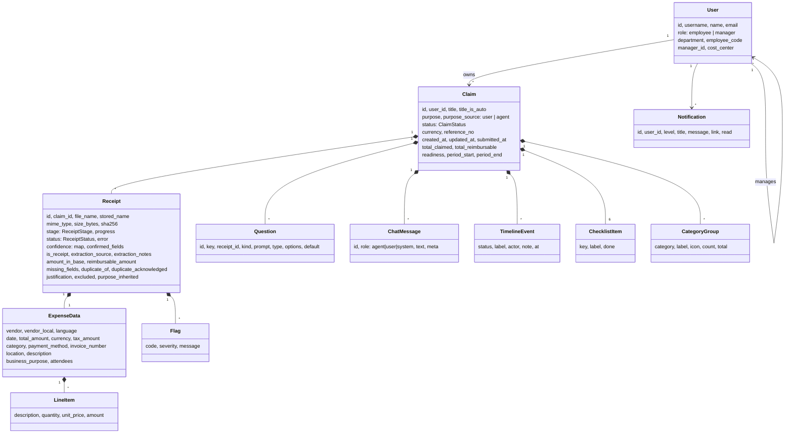

**Enumerations**

| Enum | Values |
|---|---|
| `ClaimStatus` | `draft`, `processing`, `needs_attention`, `ready`, `submitted`, `approved`, `rejected`, `paid` (the first four are editable) |
| `ReceiptStage` | `uploaded`, `reading`, `extracting`, `verifying`, `categorising`, `validating`, `duplicate_check`, `completed`, `failed` |
| `ReceiptStatus` | `processing`, `complete`, `needs_info`, `questionable`, `excluded`, `failed` |
| Question `kind` | a field name (`vendor`, `date`, `total_amount`, `currency`, `category`, `business_purpose`, `attendees`, `description`), `duplicate`, `not_receipt`, `confirm_amount`, `justification`, `purpose` |
| Question `type` | `text`, `number`, `date`, `select`, `choice` |

Derived values (`total_*`, `readiness`, `checklist`, `groups`, `period_*`, `questions`, `status`, the auto `title`) are stored for fast reads, but always recomputed by `ClaimService.recompute()`. Nothing else writes them.

---

## 6. API design

Interactive OpenAPI docs: `http://localhost:8100/docs`. All endpoints are under `/api` and need `Authorization: Bearer <JWT>`, except login, demo-users and health.

| Method & path | Purpose | Notes |
|---|---|---|
| `POST /auth/login` | Sign in | constant-time password comparison; returns JWT + public user |
| `GET /auth/me` | Current user | |
| `GET /auth/demo-users` | Demo credentials for the login page | disabled when `auth.show_demo_users: false` |
| `GET /claims` | My claims (summaries) | newest first |
| `POST /claims` | Create claim | optional title/purpose |
| `GET /claims/{id}` · `PATCH` · `DELETE` | Read / rename / edit remarks / delete draft | 404 for other users' claims; 409 when locked |
| `POST /claims/{id}/receipts` | Upload files (multipart, many) | 202, processed in the background; type/size/empty validation → 400 |
| `PATCH /claims/{id}/receipts/{rid}` | Manual edits | typed validation → 422 |
| `DELETE /claims/{id}/receipts/{rid}` · `POST …/retry` | Remove / re-run a receipt | |
| `GET /claims/{id}/receipts/{rid}/file?download=` | View/download original | `?access_token=` allowed for `` |
| `GET /claims/{id}/attachments.zip` | All documents, numbered | |
| `POST /claims/{id}/questions/{qid}/answer` | Answer a question | 422 on invalid answers |
| `POST /claims/{id}/chat` | Talk to the agent | returns the updated claim |
| `POST /claims/{id}/submit` | Submit to finance | 409 unless `ready` |
| `POST /claims/{id}/reopen` | Reopen a returned claim | 409 unless `rejected` |
| `GET /claims/{id}/export` | CSV export | |
| `GET /approvals` · `GET /approvals/{id}` | Manager queue / detail | 403 for non-managers; direct reports only |
| `POST /approvals/{id}` | `{"decision": "approve" \| "reject", "comment"}` | 409 unless submitted |
| `GET /approvals/{id}/receipts/{rid}/file` · `/attachments.zip` | Manager document access | |
| `GET /notifications` · `POST /notifications/read-all` · `POST /notifications/{id}/read` | Notification centre | |
| `GET /events/stream` | **SSE**: `ready`, `claim.updated`, `notification` | `?access_token=` (EventSource can't send headers) |
| `GET /dashboard` | KPIs, spend by category, recent claims, pending approvals | |
| `GET /config` | Policy-aware UI config (categories, currencies, stages, limits) | |
| `GET /settings/llm` · `PUT /settings/llm` · `POST /settings/llm/{provider}/test` | AI engine status, runtime switch, live health check | |
| `GET /health` | Liveness | |

Domain exceptions map to HTTP status codes in one place ([`main.py`](../backend/app/main.py)): `AnswerError` → 422, `UploadError` → 400, `ClaimLockedError` / `GatewayError` → 409.

---

## 7. Frontend design

| Route | Screen | Highlights |
|---|---|---|
| `/login` | Animated sign-in | demo-account picker, show/hide password, shake on error |
| `/dashboard` | Personal dashboard | KPIs with count-up animation, spend by category, recent claims, manager's pending approvals |
| `/agent` · `/agent/:id` | **Agent workspace** | chat with typing indicator and quick prompts; question cards; drag-and-drop/paste/browse drop zone; live receipt cards with a per-stage stepper; journey stepper; readiness ring and checklist; agent-written remarks; category breakdown; receipt drawer for edits/retry/remove; document viewer; submit dialog with policy adjustments and confetti |
| `/claims` · `/claims/:id` | Claims list / detail | status filter tabs; status timeline (audit trail); attachments; CSV/ZIP export; *Fix & resubmit* for returned claims |
| `/approvals` · `/approvals/:id` | Manager queue / review | items needing attention first; decision panel with comment; documents side by side |
| `/settings` | Settings | AI engine switcher with live health checks; policy table; profile |

| Live pipeline (each card steps through the stages) | Policy results (hotel capped, beer deducted) | Manager review and decision |
|---|---|---|
| 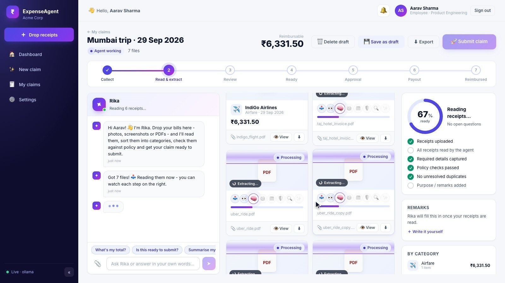 | 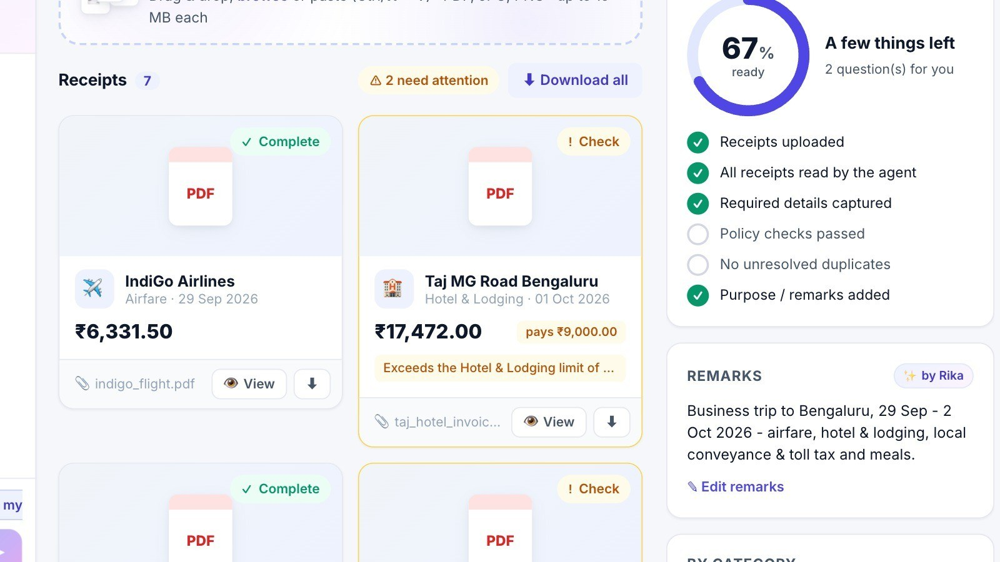 | 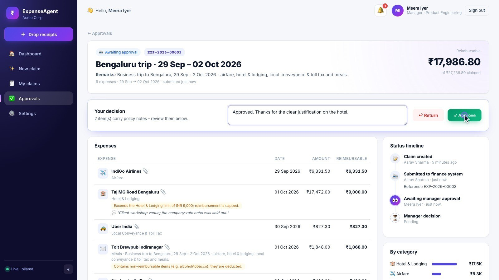 |

**State and reactivity.** Components use Angular **signals** and `computed()` for derived state, with zoneless change detection. The workspace keeps one `claim` signal. HTTP responses and SSE pushes both feed it through `apply()`, which keeps the newest snapshot.

**Unsaved new claims.** `/agent` shows a local, unsaved claim. It's persisted on the first real action (upload, chat or *Save as draft*), and the URL switches to `/agent/:id` without remounting (a custom `UrlMatcher` serves both URLs with one route), so the upload keeps its progress.

**Runtime config.** `public/config/app-config.json` holds the API URL, toast duration, SSE reconnect delay and quick chat prompts, all editable without a rebuild. It's loaded before bootstrap with `HttpBackend`, which bypasses the interceptors that depend on it.

**Cross-cutting concerns.** The `authInterceptor` adds the bearer token, logs out on 401 with a "Session expired" toast and shows "Server unreachable" when the backend is down. `errorMessage()` turns FastAPI errors into readable text. Route guards cover authenticated, guest and manager-only routes.

---

## 8. Configuration

Settings are layered (highest priority first): **environment variables** (`ERA_<SECTION>__<KEY>`), then `backend/.env`, then [`config/settings.yaml`](../backend/config/settings.yaml), then code defaults ([`core/config.py`](../backend/app/core/config.py)).

| File | Controls |
|---|---|
| `backend/config/settings.yaml` | app name, agent persona (`Rika`), company, base currency; server/CORS; JWT; storage limits and allowed types; **LLM provider, models, effort, fallback chain, concurrency**; pipeline (stage delay, DPI, pages, confidence threshold, `verify_mode`); mock finance (reference prefix, approval required, auto-approve threshold, payout delay); notifications |
| `backend/config/policy.yaml` | receipt age, purpose requirement, weekend rule, duplicate tolerances, required fields, blocked keywords, FX rates, and **19 categories** (label, icon, per-item limit, extra required fields, keywords incl. Hindi, exclusions) |
| `backend/data/users.json` | demo users, roles, reporting lines, cost centres |
| `frontend/public/config/app-config.json` | API base URL, toast duration, reconnect delay, quick prompts |

Examples:

```bash
ERA_LLM__PROVIDER=claude
ERA_LLM__CLAUDE__API_KEY=sk-ant-...
ERA_LLM__OLLAMA__VISION_MODEL=qwen2.5vl:7b
ERA_PIPELINE__VERIFY_MODE=always
ERA_REIMBURSEMENT__AUTO_APPROVE_BELOW=2000
ERA_SERVER__CORS_ORIGINS='["https://expenses.example.com"]'
```

---

## 9. Setup & deployment

### 9.1 Prerequisites

| Tool | Version (tested) |
|---|---|
| Python | 3.12+ (3.13.5) |
| Node.js / npm | 20+ (24.2 / 11.3) |
| Ollama *(default AI engine)* | recent, with `gemma3:4b` (3.3 GB) or `qwen2.5vl:7b` |
| Claude API key *(optional)* | for the Claude engine |

No database or other services are needed.

### 9.2 Run locally

```bash
# 1. Backend  (http://localhost:8100, OpenAPI docs at /docs)
cd backend
python3 -m venv .venv && source .venv/bin/activate
pip install -r requirements.txt
cp .env.example .env            # optional: provider, Claude key, JWT secret
python run.py

# 2. AI engine (pick one)
ollama pull gemma3:4b && ollama serve           # default: local and private
# or: ERA_LLM__PROVIDER=claude + ERA_LLM__CLAUDE__API_KEY=sk-ant-... in backend/.env
# or: ERA_LLM__PROVIDER=mock   (offline; reads PDF text layers only)

# 3. Frontend  (http://localhost:5200)
cd frontend
npm install
npm start
```

Sign in with a demo account: `employee / employee123` (Aarav, reports to Meera), `priya / priya123`, or `manager / manager123` (Meera). Then drop the files from `backend/samples/` into a new claim. To regenerate them, run `python scripts/generate_samples.py`.

### 9.3 Run the tests

```bash
cd backend && pip install -r requirements-dev.txt && python -m pytest --cov=app
cd frontend && npx ng test --watch=false --coverage
```

### 9.4 Production deployment

The backend keeps its event bus and JSON store in process, so it must run as **a single uvicorn worker** (see [§14](#14-limitations--future-work) for scaling out).

**Backend**

```bash
cd backend && pip install -r requirements.txt
export ERA_AUTH__JWT_SECRET="$(openssl rand -hex 32)"
export ERA_AUTH__SHOW_DEMO_USERS=false
export ERA_SERVER__CORS_ORIGINS='["https://expenses.example.com"]'
export ERA_LLM__PROVIDER=ollama          # or claude + ERA_LLM__CLAUDE__API_KEY
uvicorn app.main:app --host 0.0.0.0 --port 8100 --workers 1 --timeout-graceful-shutdown 3
```

Keep `backend/storage/` on a persistent volume. Run uvicorn under a process manager such as systemd or supervisord.

**Frontend**

```bash
cd frontend && npm ci && npx ng build            # output: dist/frontend/browser
# set apiBaseUrl in dist/frontend/browser/config/app-config.json, e.g. "https://expenses.example.com/api"
```

**nginx** (static SPA + API proxy; SSE must not be buffered):

```nginx
server {
  listen 443 ssl;
  server_name expenses.example.com;
  root /srv/expense-agent/browser;

  location / { try_files $uri $uri/ /index.html; }

  location /api/events/stream {
    proxy_pass http://127.0.0.1:8100;
    proxy_http_version 1.1;
    proxy_set_header Connection "";
    proxy_buffering off;
    proxy_read_timeout 1h;
  }

  location /api/ {
    proxy_pass http://127.0.0.1:8100;
    client_max_body_size 100m;          # many receipts per upload
  }
}
```

**Hosting status.** No public instance is hosted for this submission. The app runs locally as described above.

### 9.5 Troubleshooting

| Symptom | Fix |
|---|---|
| "Server unreachable" toast | Start the backend; check `apiBaseUrl` in `app-config.json` and `server.cors_origins` |
| Photos come back empty, "Offline engine active" banner | Switch the engine to Ollama or Claude in **Settings** and click **Re-read** |
| Ollama health check says a model is missing | `ollama pull gemma3:4b` (or the configured model) |
| Handwritten bills misread | Use `qwen2.5vl:7b` or Claude; set `pipeline.verify_mode: always` |
| Reset demo data | Stop the backend and delete `backend/storage/` |

---

## 10. Testing & reliability

### 10.1 Strategy

Both suites are **hermetic** and **deterministic**, so they run anywhere in seconds and never flake:

* **No network, no real model.** Ollama is exercised through `httpx.MockTransport`, Claude through a fake SDK client, and the agent through a scripted LLM registry. The offline `MockProvider` drives the end-to-end API tests.
* **No real data.** Before the app is imported, `tests/conftest.py` points storage at a temporary folder, selects the mock provider and zeroes every delay. A Python **audit hook** also fails any test that opens, lists or deletes anything under the real `backend/storage/`.
* **No wall-clock coupling.** Dates are computed relative to today, pipeline stage delays and payout delays are zero, and async code runs under `pytest-asyncio`.
* **Frontend.** Angular's unit-test builder runs Vitest with jsdom. API calls go through `HttpTestingController`, the realtime service is replaced by a fake (no `EventSource`), and a global setup file resets `localStorage`, timers, spies and stubs after every test.
* **Behaviour over implementation.** Test names read as specifications, for example `test_a_handwritten_marathi_memo_is_verified_and_translated`, `test_a_business_trip_goes_from_upload_to_payout` or `test_slow_subscribers_drop_events_instead_of_blocking`.
* **Mutation check.** As a check that the tests detect regressions, deliberate defects were injected: 19 into the backend at runtime (for example, dropping the currency conversion or the claim-ownership check) and 18 into the frontend. Every one made at least one test fail. Both suites also pass under random hash seeds and with the test modules in reverse order.

### 10.2 Results

| Suite | Files | Tests | Outcome | Coverage | Run time |
|---|---|---|---|---|---|
| **Backend** (pytest) | 20 test modules | **831** | all passed | **100 %** of 2,590 statements · 99.9 % with 634 branches | ≈ 20 s |
| **Frontend** (Vitest) | 40 spec files | **536** | all passed | **99.4 %** statements · 96.9 % branches · 99.8 % functions · **100 %** lines | ≈ 15–20 s |

### 10.3 What is covered

**Backend** (`backend/tests/`)

| Module | Tests | Focus |
|---|---|---|
| `test_normalizers.py` | 101 | JSON extraction from chatty model output, amounts, currency symbols, day-first dates, Indic digits, bill numbers, script detection |
| `test_rule_extractor.py` | 77 | Text-layer parsing: totals, taxes, dates, invoice numbers, payment method, city, line items, currencies |
| `test_extraction_service.py` | 71 | Prompt assembly, normalisation, gap-filling, line-item reconciliation, verification (keep-the-better reading), localisation, confidence finalisation, unreadable-photo warnings |
| `test_claim_service.py` | 71 | `recompute()`: statuses, totals, groups, checklist and readiness, auto-titles; answers; typed field validation; remarks precedence and inheritance |
| `test_policy_engine.py` | 66 | Categorisation (Latin and Indic keywords, exclusions, ties), every flag, FX, deductions, caps, low confidence, justification rules |
| `test_agent_service.py` | 72 | Full pipeline with fakes, stage broadcasting, failure isolation, retries, resume after restart, uploads, answers, chat actions (including replays of the misfires seen with `gemma3:4b`), purpose inference, deletion races |
| `test_chat_guard.py` | 68 | Grounding rules for every kind of chat action: questions never answer, echoes are rejected, amounts/dates/categories/currencies must be stated, choices need an explicit request, remarks are replaced only when asked; the own-words fallback |
| `test_llm_providers.py` | 55 | Offline provider intents; Ollama payloads, zoom tiles, errors and health checks; Claude content blocks, effort, refusals and API errors |
| `test_api.py` | 48 | Auth, claim CRUD, upload → processing → submit → approve → payout, ownership (404) and role (403) rules, receipts, attachments, export, SSE, settings, dashboard, startup recovery |
| `test_extraction_checks.py` | 32 | Every deterministic check and its tolerance |
| `test_core.py` | 28 | Settings layering (args > env > .env > YAML), JWT lifecycle, event bus fan-out and back-pressure, test isolation itself |
| `test_purpose_service.py` | 27 | Deterministic remarks, LLM polish, the privacy guard, fallbacks |
| `test_reimbursement_gateway.py` | 22 | Reference numbers (never reused, kept on resubmission), routing, auto-approval, decisions and authorisation, payout scheduling and resume |
| `test_question_engine.py` | 19 | The minimum-question rules and stable question ids |
| `test_repositories.py` | 19 | Atomic JSON store; claim, notification and user repositories; the persisted reference counter |
| `test_models.py` · `test_duplicate_detector.py` · `test_document_reader.py` · `test_llm_registry.py` · `test_notification_service.py` | 55 | Domain models, hash and fuzzy duplicates, PDF and image reading, provider fallback and concurrency, notifications |

**Frontend** (`frontend/src/**/*.spec.ts`, helpers in `frontend/testing/`). Routes and app wiring (23 tests); core services such as the API clients, auth service, interceptor and guards, config, policy store, display helpers, realtime and notification centre, and toasts (123); the agent workspace and its components such as question cards, chat panel, receipt card and drawer, journey, submit dialog and drop zone (184); pages and layout such as login, dashboard, claims list and detail, approvals, settings, shell, notification bell and toast stack (115); shared components and pipes (91).

### 10.4 Defects found by the test suite, and fixed

Writing the tests surfaced real defects. Each was first pinned by a strict `xfail` (or `it.skip`) test documenting the expected behaviour, then fixed. Those tests now run as ordinary regression tests.

| # | Where | Defect | Fix |
|---|---|---|---|
| 1 | `rule_extractor.py` | The `AMOUNT` regex preferred 1–3 digit groups, so `Total Amount Rs. 1848.00` was read as 184.0 | Comma-grouped numbers require a separator; otherwise the whole digit run is read |
| 2 | `rule_extractor.py` | dd-mm-yy and dd.mm.yy dates matched the pattern but had no parse format | Added `%d-%m-%y` and `%d.%m.%y` |
| 3 | `rule_extractor.py` | `$` was tested before `S$`, so SGD receipts were read as USD | SGD is checked first (without matching inside `US$`) |
| 4 | `mock_provider.py` | Same regex as #1 when coercing chat answers ("1500" → 150) | Fixed by #1 |
| 5 | `extraction_service.py` | Non-object `fields` / `confidence` from the model failed the receipt | Falls back to top-level keys and default confidence |
| 6 | `agent_service.py` | Non-object items in the model's `answers` / `updates` gave HTTP 500 | Only object entries are considered |
| 7 | `claim_service.py` | A blank answer to the purpose question gave HTTP 500 | Validated, giving 422 "Please type an answer" |
| 8 | `agent_service.py` | A claim deleted while the LLM was replying or writing remarks was re-saved | The claim is re-fetched after every await and never re-created |
| 9 | `routes/auth.py` | `secrets.compare_digest` on non-ASCII `str` raised, so "é" or "₹" in a password gave HTTP 500 | Passwords are compared as UTF-8 bytes, giving 401 |
| 10 | `claim_repository.py`, `reimbursement_gateway.py` | Reference numbers could repeat after a resubmission or deletion | Persisted monotonic counter; resubmitted claims keep their reference |
| 11 | `settings.ts` (frontend) | `replace('_', ' ')` humanised only the first underscore | `replaceAll` |

The chat misbehaviour seen during the demo (§4.13) was fixed at the same time: `ChatGuard`, the own-words fallback and honest replies, with 68 guard tests plus agent-level replays of the observed conversation.

### 10.5 Running the tests

```bash
# Backend
cd backend
pip install -r requirements-dev.txt
python -m pytest                                    # 831 tests, ~20 s
python -m pytest --cov=app --cov-report=term-missing

# Frontend
cd frontend
npx ng test --watch=false                           # 536 tests
npx ng test --watch=false --coverage                # report in coverage/frontend/
```

### 10.6 Reliability built into the product

| Risk | Mitigation |
|---|---|
| AI engine down or refusing | Fallback chain (`llm.fallback_chain`), and Claude refusals mapped to fallbacks. The failure reason is surfaced on the receipt, with **Retry** and manual edit |
| One bad document | Every receipt runs in its own task; errors mark only that receipt as `failed` |
| Model misreads | Deterministic checks → verification pass → confidence downgrade → confirmation question |
| Untrusted model output | Every value is normalised and validated, and money decisions are made by the policy engine |
| Server restart | Interrupted receipts and pending payouts resume at startup |
| Crash during a write | Atomic JSON writes (temp file + `os.replace`) |
| Concurrent updates in the UI | Snapshots are applied only when newer (`updated_at`), and SSE auto-reconnects |
| GPU / rate-limit pressure | `asyncio.Semaphore(max_concurrency)` around all model calls |

---

## 11. Code walkthrough

### 11.1 Repository layout

```
backend/
  app/
    main.py              FastAPI app, CORS, error mapping, lifespan (resume work)
    container.py         composition root (dependency injection)
    core/                config (YAML + env), JWT, SSE event bus
    models/              domain.py (Claim, Receipt…), policy.py, api.py (schemas)
    repositories/        json_store.py + claim / notification / user repositories
    services/            agent, extraction (+ checks, normalizers, rule extractor),
                         policy engine, duplicates, questions, claim service,
                         purpose, notifications, mock finance gateway
      llm/               base (LLMRequest, LLMProvider), registry, ollama, claude, mock
    api/                 deps (auth guards), attachments, routes/*
  config/                settings.yaml, policy.yaml
  data/users.json        demo users
  samples/               demo receipts (PDF with text layer + photo)
  scripts/               generate_samples.py
  tests/                 pytest unit tests
frontend/src/app/
  core/                  config, auth, api clients, realtime, toasts, models
  layout/                shell (sidebar, top bar), notification bell, toast stack
  features/              auth, dashboard, agent workspace, claims, approvals, settings
  shared/                reusable components and pipes
docs/                    this document
```

### 11.2 Life of a receipt, in code

1. **Upload.** `routes/claims.upload_receipts` reads the multipart files. `AgentService.add_receipts` validates the extension, size and emptiness, computes SHA-256, stores the file as `uploads/<user>/<claim>/<uuid><ext>`, appends `Receipt` objects, posts a chat message, saves, publishes, and spawns `_process_batch` as a background task. The HTTP call returns `202` immediately.
2. **Pipeline.** `_process_batch` runs `_process_receipt` for all receipts concurrently with `asyncio.gather`. Each stage calls `_advance()`, which sets the stage and progress, runs `ClaimService.recompute()`, persists, publishes `claim.updated` over SSE, and sleeps for `stage_delay_ms`.
3. **Extraction.** `ExtractionService.extract → review → should_verify → verify → localise → finalise` ([§4](#4-ai-models--algorithms)).
4. **Rules.** `PolicyEngine.categorise` then `evaluate`. Duplicate detection runs inside `recompute()` once the receipt is `completed`, so it can compare against fully processed receipts.
5. **Wrap-up.** `_infer_purpose` (agent-written remarks), a final `recompute`, the `_batch_summary` chat message (found items, failures, totals, remarks, questions), a "Receipts processed" notification, and a "Ready to submit" notification if the claim just became ready.

### 11.3 `ClaimService.recompute()`: the single source of truth

```python
def recompute(self, claim: Claim) -> None:
    if not claim.is_editable:
        return
    other_claims = [c for c in self._claims.for_user(claim.user_id) if c.id != claim.id]
    candidates = [r for c in other_claims for r in c.receipts] + claim.receipts
    for receipt in claim.receipts:
        if receipt.stage == ReceiptStage.COMPLETED and not receipt.excluded:
            self._inherit_purpose(claim, receipt)       # remarks → business purpose
            self.check_receipt(receipt, candidates)     # duplicates + policy flags
    claim.questions = self._questions.build(claim)      # minimum question set
    self._refresh_receipt_statuses(claim)
    self._refresh_totals(claim)                         # totals, groups, period
    self._refresh_checklist(claim)                      # readiness %
    claim.status = self._derive_status(claim)
    if claim.title_is_auto:
        claim.title = self._auto_title(claim)           # e.g. "Bengaluru trip · 1–3 Oct 2026"
```

Every mutation (upload stage, answer, chat action, manual edit, deletion) ends with `recompute()`. Because derived state is never patched by hand, the UI, totals and status always agree.

### 11.4 Provider fallback

```python
async def generate(self, request: LLMRequest) -> LLMResult:
    chain = [self._active, *(n for n in self._fallback_chain if n != self._active)]
    errors: list[str] = []
    async with self._semaphore:                       # cap concurrent model calls
        for index, name in enumerate(chain):
            try:
                text = await self._providers[name].generate(request)
                return LLMResult(text=text, provider=name, fell_back=index > 0, errors=errors)
            except LLMError as exc:
                errors.append(f"{name}: {exc}")
    raise LLMError("; ".join(errors))
```

`LLMResult.provider` and `fell_back` flow back into the receipt (`extraction_source`). The UI can therefore explain, for example, that a photo couldn't be read because Ollama was down and the offline engine only reads text layers.

### 11.5 Verification keeps the better reading

```python
checked = self._normalise(parse_json_object(result.text), result.provider, result.fell_back)
self._keep_missing(checked, draft)           # never lose a field the first pass found
if document.text:
    self._fill_gaps_from_text(checked, document.text)
checked.verified = True
return checked if len(self.review(checked)) <= len(issues) else draft
```

### 11.6 Frontend: live workspace

`AgentWorkspace` subscribes to `RealtimeService.claimUpdates`, filtered to the open claim, and to HTTP responses. Both go through `apply(update)`, which ignores snapshots older than the current one. Child components (`ChatPanel`, `QuestionCard`, `ReceiptCard`, `ClaimJourney`, `ReadinessRing`) are pure, input-driven standalone components that emit events upward, which keeps them simple to test.

### 11.7 Coding conventions

* Typed end to end: Pydantic models in the backend, TypeScript interfaces in [`core/models/models.ts`](../frontend/src/app/core/models/models.ts) mirroring them.
* No hard-coded business rules in services: categories, limits, keywords, FX, tolerances and timings come from configuration.
* Domain errors are exceptions with a single HTTP mapping. Services stay free of HTTP concerns.
* Small, single-purpose modules (the largest service is about 500 lines), docstrings on every module, and comments only where the reasoning isn't obvious.

---

## 12. Assumptions

1. **One company, one base currency (INR).** Foreign amounts are converted at static **policy rates** from `policy.yaml`, not live market rates, which is common practice for reimbursement.
2. **Limits are per receipt** (`limit_per_item`), not per day or per trip.
3. **Single-level approval.** Each employee has one `manager_id`, who approves. Optional auto-approval below a threshold.
4. **The finance system is mocked.** Reference numbers, approvals and payouts are simulated by `MockReimbursementGateway` behind an interface that a real ERP/payroll adapter can replace.
5. **Demo identity.** Users live in `users.json` with plaintext demo passwords, on purpose for the hackathon. Production would use SSO/OIDC and hashed credentials.
6. **Single-process deployment.** The in-memory event bus and JSON store assume one backend process.
7. **Documents.** Receipts are PDFs or images up to 15 MB. Only the first 3 PDF pages are read. One document holds one expense; the notes field flags pages with several receipts.
8. **Indian conventions.** Dates on bills are day-first. ₹/Rs/रु mean INR. Cash memos are paid in cash unless stated otherwise. Diesel implies a car.
9. **LLM output is untrusted.** Every value is normalised and validated, and the policy engine, not the model, decides every amount that gets reimbursed.
10. **`receipt_required_above`** is published to the UI as policy information. All expenses in this flow come with a document, so it isn't enforced as a separate rule.

---

## 13. Security & privacy

| Concern | Measure |
|---|---|
| Authentication | JWT bearer tokens (HS256, configurable secret and TTL, 8 h by default); constant-time password comparison |
| Authorisation | Claims are scoped to their owner (others get 404, so their existence isn't revealed); manager routes need the manager role (403); only the employee's own manager can decide a claim |
| Uploads | Extension allow-list, size limit, empty-file rejection; stored under random UUID names outside the web root; served with the stored MIME type |
| Locked claims | Submitted claims can't be edited, deleted or re-processed (409) |
| CORS | Explicit origin allow-list |
| Prompt injection | Receipts are treated as untrusted data. Model output is parsed as JSON, normalised and validated. Chat actions are limited to whitelisted field updates and must be grounded in the employee's own message (`ChatGuard`), and the model can't submit, approve or delete |
| Data privacy | Ollama mode keeps documents on the machine. Purpose inference drops any text naming the employee. The Claude engine sends documents to Anthropic only when explicitly selected |
| Tokens in URLs | `EventSource` and `` can't send headers, so `?access_token=` is accepted. In production, use short-lived tokens or cookie-based auth and keep tokens out of access logs |

---

## 14. Limitations & future work

| Limitation | Next step |
|---|---|
| JSON file store, single process | PostgreSQL via the repository interfaces; Redis pub/sub for SSE across instances; a task queue (Celery/RQ/Arq) for the pipeline |
| Demo authentication | SSO (OIDC/SAML), hashed passwords, refresh tokens, cookie-based SSE auth |
| Mock finance system | Adapters for SAP Concur / Oracle / payroll APIs behind the gateway interface |
| Per-item limits only | Per-diem, daily/trip caps, grade-based limits, multi-level approvals and delegation |
| Small local model accuracy on handwriting | Larger vision model (`qwen2.5vl:7b`) or Claude; a labelled evaluation set to measure field-level accuracy per engine |
| Small local models (e.g. `gemma3:4b`) often fail to extract answers from free-form chat. `ChatGuard` stops wrong actions (§4.13), but the model may still miss an answer it should have recorded | Use a stronger chat model (`llm.ollama.chat_model`, or Claude via `llm.claude.chat_model`). The question cards are deterministic and always work |
| Static FX rates | Daily rates from a treasury feed, keeping the policy-rate override |
| English-only UI | i18n (Hindi and regional languages); mobile PWA capture with an edge-detection camera |
| Basic fraud checks | GSTIN validation, image-tampering detection, vendor blacklist, anomaly detection across employees |
| Any signed-in user can switch the server-wide AI engine (a demo convenience) | Restrict `PUT /settings/llm` to an admin role |
| A manager can open a direct report's unsubmitted, non-draft claim by URL (`approvals.py:16` hides only drafts) | Use the same status filter as the approval queue |
| Synchronous routes publish SSE events from worker threads into `asyncio.Queue`, which isn't thread-safe | Publish through `loop.call_soon_threadsafe`, or make those routes `async` |
| If one file in a multi-file upload is rejected, files saved before it stay on disk | Validate the whole batch before writing anything |

---

## Appendix A. Sample receipts & expected behaviour

Generated by `backend/scripts/generate_samples.py` (dates are relative to the generation day).

| File | Content | Expected agent behaviour |
|---|---|---|
| `indigo_flight.pdf` | IndiGo BOM→BLR, ₹6,331.50 | Airfare; within limit |
| `taj_hotel_invoice.pdf` | Taj MG Road, 2 nights, ₹17,472 | Hotel & Lodging; **capped at ₹9,000**; asks for a justification |
| `uber_ride.pdf` | Uber airport → MG Road, ₹827.30 | Local Conveyance & Toll Tax |
| `uber_ride_copy.pdf` | identical file | **Duplicate** (same SHA-256) → *Remove duplicate / Keep both* |
| `client_dinner.pdf` | Toit Brewpub, ₹1,848 incl. craft beer ₹780 | Meals; **beer deducted** as non-reimbursable; purpose inherited from remarks |
| `starbucks_coffee.pdf` | Starbucks, ₹490 | Meals |
| `chai_point_photo.png` | **photo** of a café bill, ₹270 | Read by the **vision model** (needs Ollama/Claude; flagged as unreadable by the offline engine) |
| `jiofiber_broadband_bill.pdf` | JioFiber, ₹1,178.82 | Broadband Reimbursement |
| `indian_oil_bike_fuel.pdf` | Petrol for an Activa, ₹333.47 | Fuel Expenses – Two Wheeler |
| `apollo_pharmacy_bill.pdf` | Pharmacy, ₹284 | Medical Reimbursement |
